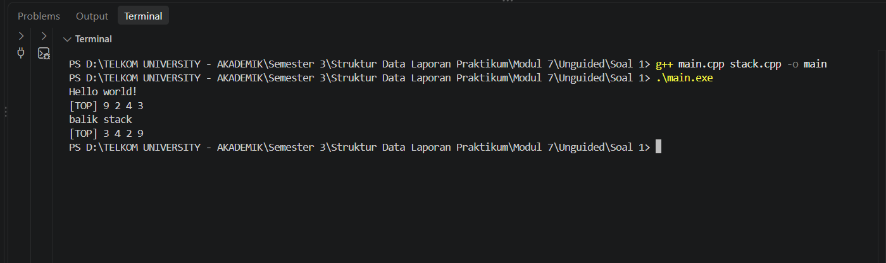
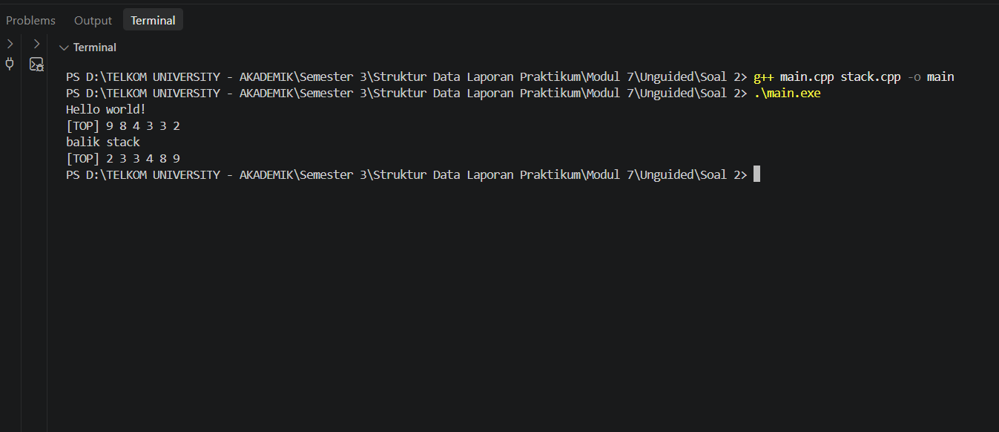
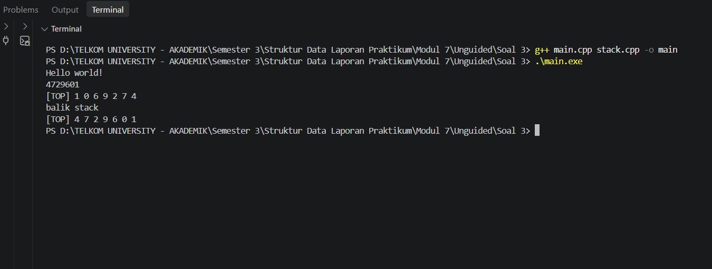

# <h1 align="center">Laporan Praktikum Modul 7 - Stack</h1>
<p align="center">Nehemia Pandu Indragiri - 109082500019</p>

## Dasar Teori
Stack merupakan struktur data yang prinsip operasinya seperti tumpukan, di mana elemen yang diambil terlebih dahulu adalah elemen paling atas, yaitu elemen yang terakhir kali dimasukkan. Prinsip ini disebut LIFO (Last In First Out). Akses pada stack hanya dapat dilakukan pada elemen paling atas yang disebut Top. Seluruh operasi pada stack disusun dalam bentuk ADT yang terbagi menjadi file .h untuk deklarasi type dan prototype primitif, file .cpp untuk realisasi primitif, serta main.cpp sebagai program utama. Agar file header tidak terbaca dua kali, digunakan #ifndef, #define, dan #endif.

Stack dapat direpresentasikan dengan pointer atau tabel. Pada representasi pointer, setiap elemen terdiri dari info dan next, stack dinyatakan kosong apabila Top bernilai Nil, dan diperlukan manajemen memori berupa alokasi (new) dan dealokasi (delete). Pada representasi tabel, stack dibentuk menggunakan array berindeks dengan jumlah elemen terbatas, Top berupa bilangan bulat penunjuk indeks elemen teratas, dan tidak diperlukan manajemen memori.

Dua operasi utama dalam stack adalah push dan pop. Push adalah operasi menyisipkan elemen ke dalam stack. Pada representasi pointer, push sama dengan insert first, sedangkan pada representasi tabel dilakukan dengan Top = Top + 1 lalu menyimpan data pada indeks Top. Pop adalah operasi mengambil elemen paling atas. Pada representasi pointer, pop mirip dengan delete first, sedangkan pada representasi tabel dilakukan dengan menyimpan info pada indeks Top lalu Top = Top - 1.

Primitif dalam stack meliputi createStack untuk membentuk stack kosong, isEmpty untuk mengecek stack kosong, serta printInfo untuk menampilkan isi stack dari Top. Selain itu terdapat balikStack untuk membalik urutan elemen, pushAscending untuk menyisipkan elemen dengan tetap menjaga urutan sehingga elemen terbesar berada di Top, dan getInputStream untuk membaca input pengguna menggunakan cin.get() dan memasukkannya ke dalam stack hingga pengguna menekan enter. [3]

## Guided

### 1. Barang

```C++
#ifndef STACK_H_INCLUDED
#define STACK_H_INCLUDED

#include <iostream>
using namespace std;

struct infotype {
    char nim[20];
    char nama[20];
};

struct Stack {
    infotype info[10];
    int Top;
};

int isEmpty(Stack S);

void createStack(Stack &S);

void push(Stack &S, infotype X);

void pop(Stack &S, infotype &X);

void viewStack(Stack S);

#endif
```

```C++
#include "stack.h"

int isEmpty(Stack S) {
    if (S.Top == 0) {
        return 0;
    }else {
        return 1;
    }
}

void createStack(Stack &S) {
    S.Top = 0;
}

void push(Stack &S, infotype X) {
    if (S.Top < 10) {
        S.Top = S.Top + 1;
        S.info[S.Top - 1] = X;
    } else {
        cout << "Stack prnuh, data tidak bisa ditambahkan" << endl;    
    }
}

void pop(Stack &S, infotype &X) {
    if (isEmpty(S) != 0) {
        X = S.info[S.Top - 1];
        S.Top = S.Top - 1;
    } else {
        cout << "Stack kosong, tidak ada data yang bisa diambil" << endl;
    }
}

void viewStack(Stack S) {
    if (isEmpty(S) == 0) {
        cout << "Stack kosong" << endl;
    } else {
        cout << "Isi stack (dari TOP):" << endl;
        for (int i = S.Top; i >= 1; i--) {
            cout << i << ". " << S.info[i - 1].nim << " - " << S.info[i - 1].nama << endl;
        }
    }
}
```

```C++
#include <iostream>
#include <cstring>
#include "stack.h"
using namespace std;

int main() {
    Stack S;
    infotype data, hasil;

    createStack(S);
    cout << "Stack baru dibuat, Top = " << S.Top << endl;
    viewStack(S);

    cout << endl << "--- Push 3 data ---" << endl;
    strcpy(data.nim, "109082500019");
    strcpy(data.nama, "Pandu");
    push(S, data);
    
    strcpy(data.nim, "109082500039");
    strcpy(data.nama, "Indra");
    push(S, data);
    
    strcpy(data.nim, "109082510019");
    strcpy(data.nama, "Nehemmia");
    push(S, data);
    viewStack(S);

    cout << endl << "--- Pop 1 data ---" << endl;
    pop(S, hasil);
    cout << "Data yang diambil: " << hasil.nim << " - " << hasil.nama << endl;
    viewStack(S);

    cout << endl << "--- Pop sampai kosong ---" << endl;
    pop(S, hasil);
    pop(S, hasil);
    pop(S, hasil);
    viewStack(S);

    return 0;
}
```
Pada guided ini, saya belajar untuk membuat program stack menggunakan representasi tabel (array) yang menerapkan konsep ADT dengan memisahkan kode menjadi tiga file, yaitu stack.h, stack.cpp, dan main.cpp. File stack.h berisi deklarasi struct infotype dengan field nim dan nama bertipe array of char berukuran 20, serta struct Stack dengan field info berupa array infotype berukuran 10 dan field Top sebagai penunjuk indeks elemen teratas. File ini juga berisi prototipe fungsi dan prosedur yang dipakai, serta dilindungi include guard (#ifndef, #define, #endif) agar tidak terbaca dua kali. File stack.cpp berisi isi dari primitif-primitif tersebut. Fungsi isEmpty mengecek apakah Top bernilai 0, dengan nilai kembalian 0 jika stack kosong dan 1 jika stack berisi, sedangkan prosedur createStack mengatur Top menjadi 0 untuk membentuk stack kosong. Prosedur push menambah nilai Top lalu menyimpan data X pada indeks Top - 1, dengan pengecekan agar tidak melebihi kapasitas 10 elemen. Prosedur pop menyimpan data pada indeks Top - 1 ke parameter X (call by reference), lalu mengurangi nilai Top, dengan pengecekan agar tidak dijalankan saat stack kosong. Prosedur viewStack menampilkan pesan stack kosong jika stack tidak berisi, dan jika berisi akan menelusuri elemen dari Top sampai elemen terbawah sambil menampilkan NIM dan nama setiap data. Semua prosedur yang mengubah isi stack menerima parameter Stack &S (call by reference) agar perubahan langsung tersimpan di stack aslinya. Pada main.cpp, program membuat variabel S bertipe Stack serta variabel data dan hasil bertipe infotype, memanggil createStack, lalu menampilkan stack yang masih kosong dengan Top bernilai 0. Setelah itu data diisi menggunakan strcpy dan dimasukkan dengan push sebanyak tiga kali untuk Pandu, Indra, dan Nehemmia, sehingga viewStack menampilkan Nehemmia sebagai Top, diikuti Indra dan Pandu. Berikutnya pop dilakukan satu kali sehingga data Nehemmia diambil dan ditampilkan melalui variabel hasil, lalu tersisa Indra dan Pandu. Terakhir, pop dilakukan tiga kali berturut-turut sehingga seluruh isi stack terambil dan viewStack menampilkan stack kosong. Pada pop yang ketiga, stack sudah kosong sehingga yang tampil adalah pesan bahwa tidak ada data yang bisa diambil.

## Unguided 

### 1. Buatlah ADT Stack menggunakan ARRAY sebagai berikut di dalam file “stack.h”:
Type infotype : integer
Type Stack <
info : array [20] of integer
top : integer
>
procedure CreateStack( input/output S : Stack )
procedure push(input/output S : Stack,
 input x : infotype)
function pop(input/output t S : Stack )
→ infotype
procedure printInfo( input S : Stack )
procedure balikStack(input/output S :
 Stack )

Buatlah implementasi ADT Stack menggunakan Array pada file “stack.cpp” dan “main.cpp”

```C++
#ifndef STACK_H_INCLUDED
#define STACK_H_INCLUDED

#include <iostream>
using namespace std;

typedef int infotype;

struct Stack {
    infotype info[20];
    int top;
};

void createStack(Stack &S);
void push(Stack &S, infotype x);
infotype pop(Stack &S);
void printInfo(Stack S);
void balikStack(Stack &S);

#endif 
```

```C++
#include "stack.h"

void createStack(Stack &S) {
    S.top = 0;
}

void push(Stack &S, infotype x) {
    if (S.top < 20) {
        S.info[S.top] = x;
        S.top++;
    } else {
        cout << "Stack penuh!" << endl;
    }
}

infotype pop(Stack &S) {
    if (S.top > 0) {
        S.top--;
        return S.info[S.top];
    } else {
        cout << "Stack kosong!" << endl;
        return -1;
    }
}

void printInfo(Stack S) {
    cout << "[TOP] ";
    for (int i = S.top - 1; i >= 0; i--) {
        cout << S.info[i] << " ";
    }
    cout << endl;
}

void balikStack(Stack &S) {
    int i = 0;
    int j = S.top - 1;
    while (i < j) {
        infotype temp = S.info[i];
        S.info[i] = S.info[j];
        S.info[j] = temp;
        i++;
        j--;
    }
}
```

```C++
#include "stack.h"

int main() {
    cout << "Hello world!" << endl;
    Stack S;
    createStack(S);
    push(S, 3);
    push(S, 4);
    push(S, 8);
    pop(S);
    push(S, 2);
    push(S, 3);
    pop(S);
    push(S, 9);
    printInfo(S);
    cout << "balik stack" << endl;
    balikStack(S);
    printInfo(S);
    return 0;
}
```
### Output Unguided 1 :

##### Output 1



Program di atas merupakan program yang saya buat untuk membuat stack menggunakan array dengan menerapkan konsep ADT yang dibagi menjadi tiga file, yaitu stack.h untuk deklarasi, stack.cpp untuk isi prosedur, dan main.cpp sebagai program utama. File stack.h berisi alias infotype bertipe int serta struct Stack dengan field info berupa array berukuran 20 dan field top sebagai penunjuk jumlah elemen yang ada di dalam stack. File ini juga berisi prototipe prosedur dan dilindungi include guard (#ifndef, #define, #endif). Pada stack.cpp, prosedur createStack menerima parameter Stack &S (call by reference) lalu mengatur top menjadi 0 untuk membentuk stack kosong. Prosedur push menyimpan elemen baru pada indeks top lalu menambah nilai top, dengan pengecekan agar tidak melebihi kapasitas 20 elemen. Fungsi pop mengurangi nilai top lalu mengembalikan info pada indeks tersebut sebagai elemen yang diambil, dengan pengecekan agar tidak dijalankan saat stack kosong. Prosedur printInfo menelusuri stack dari elemen paling atas sampai elemen terbawah sambil menampilkan info setiap elemen. Prosedur balikStack membalik urutan elemen dengan menukar elemen paling bawah dan paling atas secara bergantian sampai bertemu di tengah. Pada main.cpp, program membuat variabel S bertipe Stack, memanggil createStack, lalu melakukan push 3, 4, dan 8, pop satu kali, push 2 dan 3, pop satu kali, dan push 9 sehingga isi stack dari bawah ke atas menjadi 3, 4, 2, 9. Karena printInfo menampilkan dari Top, hasilnya adalah 9, 2, 4, 3, kemudian setelah balikStack urutannya menjadi 3, 4, 2, 9.

### 2. Tambahkan prosedur pushAscending( in/out S : Stack, in x : integer)

```C++
#ifndef STACK_H_INCLUDED
#define STACK_H_INCLUDED

#include <iostream>
using namespace std;

typedef int infotype;

struct Stack {
    infotype info[20];
    int top;
};

void createStack(Stack &S);
void push(Stack &S, infotype x);
infotype pop(Stack &S);
void printInfo(Stack S);
void balikStack(Stack &S);

void pushAscending(Stack &S, infotype x);

#endif 
```
```C++
#include "stack.h"

void createStack(Stack &S) {
    S.top = 0;
}

void push(Stack &S, infotype x) {
    if (S.top < 20) {
        S.info[S.top] = x;
        S.top++;
    } else {
        cout << "Stack penuh!" << endl;
    }
}

infotype pop(Stack &S) {
    if (S.top > 0) {
        S.top--;
        return S.info[S.top];
    } else {
        cout << "Stack kosong!" << endl;
        return -1;
    }
}

void printInfo(Stack S) {
    cout << "[TOP] ";
    for (int i = S.top - 1; i >= 0; i--) {
        cout << S.info[i] << " ";
    }
    cout << endl;
}

void balikStack(Stack &S) {
    int i = 0;
    int j = S.top - 1;
    while (i < j) {
        infotype temp = S.info[i];
        S.info[i] = S.info[j];
        S.info[j] = temp;
        i++;
        j--;
    }
}

void pushAscending(Stack &S, infotype x) {
    if (S.top >= 20) {
        cout << "Stack penuh!" << endl;
        return;
    }

    int pos = 0;
    while (pos < S.top && S.info[pos] <= x) {
        pos++;
    }

    for (int i = S.top; i > pos; i--) {
        S.info[i] = S.info[i - 1];
    }

    S.info[pos] = x;
    S.top++;
}
```
```C++
#include "stack.h"

int main() {
    cout << "Hello world!" << endl;
    Stack S;
    createStack(S);

    pushAscending(S, 3);
    pushAscending(S, 4);
    pushAscending(S, 8);
    pushAscending(S, 2);
    pushAscending(S, 3);
    pushAscending(S, 9);

    printInfo(S);
    cout << "balik stack" << endl;
    balikStack(S);
    printInfo(S);
    return 0;
}
```
### Output Unguided 2 :

##### Output 1


Pada soal ini, program dikembangkan dengan menambahkan prosedur pushAscending untuk menyisipkan elemen ke dalam stack dengan tetap menjaga urutan elemen. Prosedur pushAscending dideklarasikan pada stack.h dengan parameter Stack &S dan infotype x. Pada stack.cpp, prosedur ini pertama-tama mengecek apakah stack sudah penuh, lalu mencari posisi sisip yang tepat, yaitu tepat setelah semua elemen yang nilainya lebih kecil atau sama dengan x. Setelah posisi ditemukan, elemen-elemen dari posisi tersebut sampai Top digeser satu langkah ke atas agar tersedia ruang kosong, kemudian x disimpan pada posisi itu dan nilai top ditambah satu. Dengan cara ini isi stack dari bawah ke atas selalu terurut naik sehingga elemen terbesar berada di Top. Pada main.cpp, pushAscending dipanggil dengan nilai 3, 4, 8, 2, 3, dan 9, sehingga isi stack menjadi 2, 3, 3, 4, 8, 9 dari bawah ke atas. Karena printInfo menampilkan dari Top, hasilnya adalah 9, 8, 4, 3, 3, 2, kemudian setelah balikStack urutannya menjadi 2, 3, 3, 4, 8, 9.

### 3. Tambahkan prosedur getInputStream( in/out S : Stack ). Prosedur akan terus membaca dan menerima input user dan memasukkan setiap input ke dalam stack hingga user menekan tombol enter. Contoh: gunakan cin.get() untuk mendapatkan inputan user.

```C++
#ifndef STACK_H_INCLUDED
#define STACK_H_INCLUDED

#include <iostream>
using namespace std;

typedef int infotype;

struct Stack {
    infotype info[20];
    int top;
};

void createStack(Stack &S);
void push(Stack &S, infotype x);
infotype pop(Stack &S);
void printInfo(Stack S);
void balikStack(Stack &S);

void getInputStream(Stack &S);

#endif
```

```C++
#include "stack.h"

void createStack(Stack &S) {
    S.top = 0;
}

void push(Stack &S, infotype x) {
    if (S.top < 20) {
        S.info[S.top] = x;
        S.top++;
    } else {
        cout << "Stack penuh!" << endl;
    }
}

infotype pop(Stack &S) {
    if (S.top > 0) {
        S.top--;
        return S.info[S.top];
    } else {
        cout << "Stack kosong!" << endl;
        return -1;
    }
}

void printInfo(Stack S) {
    cout << "[TOP] ";
    for (int i = S.top - 1; i >= 0; i--) {
        cout << S.info[i] << " ";
    }
    cout << endl;
}

void balikStack(Stack &S) {
    int i = 0;
    int j = S.top - 1;
    while (i < j) {
        infotype temp = S.info[i];
        S.info[i] = S.info[j];
        S.info[j] = temp;
        i++;
        j--;
    }
}

void getInputStream(Stack &S) {
    char c = cin.get();
    while (c != '\n') {
        if (c >= '0' && c <= '9') {
            push(S, c - '0');  
        }
        c = cin.get();
    }
}
```

```C++
#include "stack.h"

int main() {
    cout << "Hello world!" << endl;
    Stack S;
    createStack(S);

    getInputStream(S);

    printInfo(S);
    cout << "balik stack" << endl;
    balikStack(S);
    printInfo(S);
    return 0;
}
```
### Output Unguided 3 :

##### Output 1


Pada soal ini, program ditambahkan prosedur getInputStream untuk membaca input dari pengguna dan memasukkannya ke dalam stack. Prosedur getInputStream dideklarasikan pada stack.h dengan parameter Stack &S. Pada stack.cpp, prosedur ini membaca satu karakter pada satu waktu menggunakan cin.get() dan terus mengulang selama karakter yang terbaca bukan enter (‘\n’). Setiap karakter yang berupa angka diubah menjadi nilai integer dengan mengurangkan karakter ‘0’, kemudian dimasukkan ke dalam stack menggunakan push. Pada main.cpp, getInputStream dipanggil setelah createStack, lalu isi stack ditampilkan dengan printInfo. Jika pengguna mengetik 4729601, maka angka terakhir yang dimasukkan, yaitu 1, menjadi Top sehingga printInfo menampilkan 1, 0, 6, 9, 2, 7, 4. Setelah balikStack dipanggil, urutannya kembali seperti yang diketik, yaitu 4, 7, 2, 9, 6, 0, 1.

## Kesimpulan
Pada praktikum modul 7 saya belajar terkait konsep stack, yaitu salah satu bentuk struktur data yang prinsip operasinya seperti tumpukan dengan aturan LIFO (Last In First Out), di mana elemen yang terakhir dimasukkan menjadi elemen pertama yang diambil, serta penerapannya dengan memisahkan program menjadi tiga bagian, yaitu file header (.h) untuk deklarasi type dan prosedur, file body (.cpp) untuk isi prosedur, dan file driver (main.cpp) sebagai program utama. Saya juga belajar bahwa stack dapat direpresentasikan dengan pointer maupun tabel, di mana pada representasi pointer setiap elemen terdiri dari info dan next serta memerlukan manajemen memori, sedangkan pada representasi tabel stack dibentuk menggunakan array berindeks dengan jumlah elemen terbatas dan tidak memerlukan manajemen memori. Selain itu, saya mempelajari operasi-operasi dasar pada stack, seperti membentuk stack kosong dengan createStack, menyisipkan elemen dengan push, mengambil elemen paling atas dengan pop, serta menampilkan isi stack dengan printInfo yang menelusuri elemen dari Top sampai elemen terbawah. Semua materi tersebut saya terapkan dalam tiga latihan soal yang sudah diberikan, yaitu membuat ADT stack menggunakan array yang dilengkapi prosedur balikStack untuk membalik urutan elemen sehingga menghasilkan stack 9, 2, 4, 3 yang berubah menjadi 3, 4, 2, 9, kemudian menambahkan prosedur pushAscending untuk menyisipkan elemen dengan tetap menjaga urutan sehingga elemen terbesar berada di Top dan menghasilkan stack 9, 8, 4, 3, 3, 2, serta menambahkan prosedur getInputStream untuk membaca input pengguna menggunakan cin.get() dan memasukkan setiap angka ke dalam stack hingga pengguna menekan enter.

## Referensi
[1] Triase. (2020). Diktat Edisi Revisi : STRUKTUR DATA. Medan: UNIVERSTAS ISLAM NEGERI SUMATERA UTARA MEDAN. 
<br>[2] Indahyati, Uce., Rahmawati Yunianita. (2020). "BUKU AJAR ALGORITMA DAN PEMROGRAMAN DALAM BAHASA C++". Sidoarjo: Umsida Press. Diakses pada 10 Maret 2024 melalui https://doi.org/10.21070/2020/978-623-6833-67-4.
<br>[3] Laboratorium Informatika. Modul 7 - Stack. Praktikum Struktur Data, Fakultas Informatika, Telkom University.