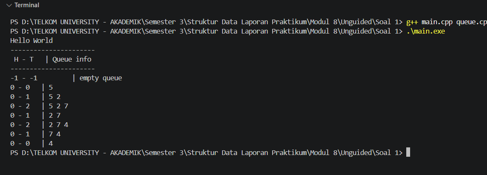
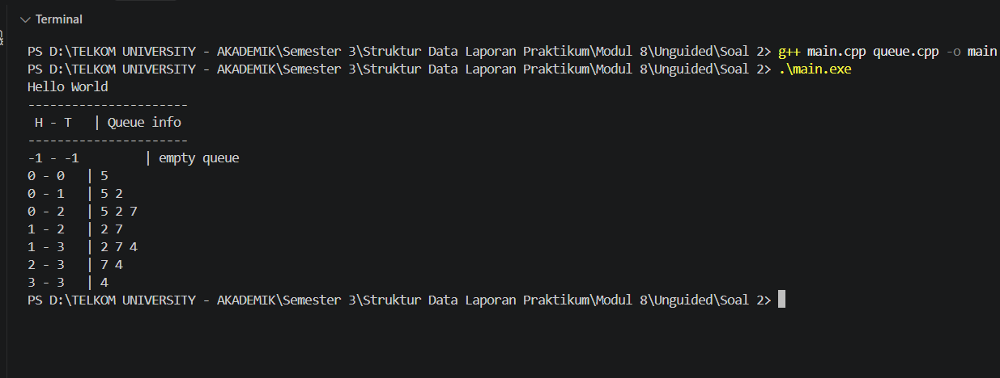
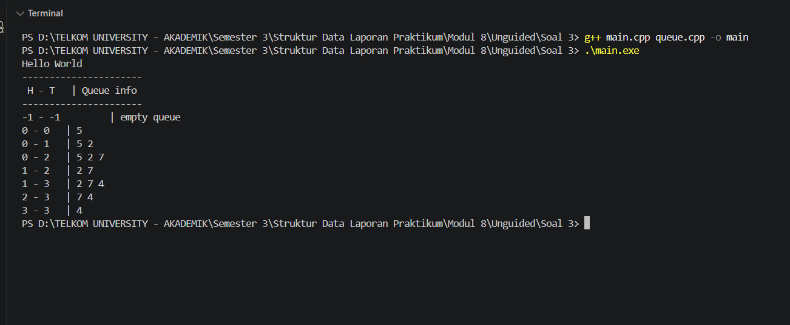

# <h1 align="center">Laporan Praktikum Modul 8 - Queue</h1>
<p align="center">Nehemia Pandu Indragiri - 109082500019</p>

## Dasar Teori
Queue merupakan struktur data yang diumpamakan seperti antrean, di mana elemen yang pertama masuk akan diakses terlebih dahulu. Prinsip ini disebut FIFO (First In First Out). Penyisipan (enqueue) selalu dilakukan pada bagian belakang yang disebut tail, sedangkan penghapusan (dequeue) selalu dilakukan pada bagian depan yang disebut head. Seluruh operasi pada queue disusun dalam bentuk ADT yang terbagi menjadi file .h untuk deklarasi type dan prototype primitif, file .cpp untuk realisasi primitif, serta main.cpp sebagai program utama. Agar file header tidak terbaca dua kali, digunakan #ifndef, #define, dan #endif.

Queue dapat direpresentasikan dengan pointer atau tabel. Pada representasi pointer, setiap elemen terdiri dari info dan next, jumlah elemen tidak terbatas, queue dinyatakan kosong apabila head bernilai Nil, dan diperlukan manajemen memori berupa alokasi (new) dan dealokasi (delete). Pada representasi tabel, queue dibentuk menggunakan array berindeks dengan jumlah elemen terbatas dan tidak memerlukan manajemen memori.

Representasi tabel memiliki tiga alternatif mekanisme. Pada Alternatif 1, head selalu diam di indeks pertama dan hanya tail yang bergerak, sehingga penghapusan elemen mengharuskan pergeseran semua elemen ke depan. Cara ini sederhana tetapi tidak efisien. Pada Alternatif 2, head dan tail sama-sama bergerak maju sehingga penghapusan cukup dengan memajukan head, tetapi dapat terjadi keadaan penuh semu, yaitu tail sudah mencapai indeks maksimum padahal masih ada ruang kosong di depan head, sehingga elemen perlu digeser. Pada Alternatif 3, head dan tail berputar mengelilingi indeks tabel sehingga setelah indeks maksimum kembali ke indeks awal. Strategi ini disebut circular buffer dan efisien karena tidak memerlukan pergeseran elemen.

Primitif dalam queue meliputi createQueue untuk membentuk queue kosong, isEmptyQueue dan isFullQueue untuk mengecek queue kosong atau penuh, enqueue untuk menyisipkan elemen di tail, dequeue untuk mengambil elemen di head, serta printInfo untuk menampilkan isi queue dari head sampai tail.[3]

## Guided

### 1. Guided 1

```C++
#ifndef QUEUE_H_INCLUDE
#define QUEUE_H_INCLUDE

#include <iostream>
using namespace std;

#define Nil NULL

typedef bool boolean;
typedef int infotype;
typedef struct elmQ *address;

struct elmQ{
   infotype info;
   address next;
};

struct queue {
   address head, tail;
};

boolean isEmpty(queue Q);
void CreateQueue(queue &Q);
address alokasi(infotype X);
void dealokasi(address P);
address findElm(queue Q, infotype X);
boolean fFindElm(queue Q, address P);
void insert(queue &Q, address P);
void deleteQueue(queue &Q, address &P);
void printInfo(queue Q);
int nbList(queue Q);
void delAll(queue &Q);

#endif
```

```C++
#include "queue.h"

boolean isEmpty(queue Q) {
    return (Q.head == Nil);
}

void CreateQueue(queue &Q) {
    Q.head = Nil;
    Q.tail = Nil;
}

address alokasi(infotype X) {
    address P = new (nothrow) elmQ;
    if (P != Nil) {
        P->info = X;
        P->next = Nil;
    }
    return P;
}

void dealokasi(address P) {
    delete P;
}

address findElm(queue Q, infotype X) {
    address P = Q.head;
    while (P != Nil) {
        if (P->info == X) {
            return P;
        }
        P = P->next;
    }
    return Nil;
}

boolean fFindElm(queue Q, address P) {
    address R = Q.head;
    while (R != Nil) {
        if (R == P) {
            return true;
        }
        R = R->next;
    }
    return false;
}

void insert(queue &Q, address P) { //enqueue
    if (isEmpty(Q)) {
        Q.head = P;
        Q.tail = P;
    } else {
        (Q.tail)->next = P;
        Q.tail = P;
    }
}

void deleteQueue(queue &Q, address &P) { //dequeue
    P = Q.head;
    if (Q.head == Q.tail) {
        Q.head = Nil;
        Q.tail = Nil;
    } else {
        Q.head = P->next;
    }
    P->next = Nil;
}

void printInfo(queue Q) {
    if (isEmpty(Q)) {
        cout << "Queue kosong" << endl;
    } else {
        address P = Q.head;
        while (P != Nil) {
            cout << P->info << " ";
            P = P->next;
        }
        cout << endl;
    }
}

int nbList(queue Q) {
    int jumlah = 0;
    address P = Q.head;
    while (P != Nil) {
        jumlah++;
        P = P->next;
    }
    return jumlah;
}

void delAll(queue &Q) {
    address P;
    while (!isEmpty(Q)) {
        deleteQueue(Q, P);
        dealokasi(P);
    }
}

```

```C++
#include <iostream>
#include "queue-array.h"
using namespace std;

int main() {
    queue Q;
    address P; 

    CreateQueue(Q);
    cout << "isEmpty : " << isEmpty(Q) << endl;
    printInfo(Q);

    insert(Q, alokasi(5));
    insert(Q, alokasi(2));
    insert(Q, alokasi(7));
    cout << "Setelah insert 5, 2, 7" << endl;
    printInfo(Q);
    cout << "nbList  : " << nbList(Q) << endl;

    P = findElm(Q, 2);
    if (P != Nil) {
        cout << "findElm(2) ketemu, info = " << P->info << endl;
        cout << "fFindElm : " << fFindElm(Q, P) << endl;
    }
    if (findElm(Q, 9) == Nil) {
        cout << "findElm(9) tidak ketemu" << endl;
    }

    deleteQueue(Q, P);
    cout << "Setelah delete, elemen yang keluar = " << P->info << endl;
    dealokasi(P);
    printInfo(Q);

    delAll(Q);
    cout << "Setelah delAll" << endl;
    printInfo(Q);
    cout << "isEmpty : " << isEmpty(Q) << endl;

    return 0;
}
```
Pada guided ini, saya belajar untuk membuat program queue menggunakan representasi pointer (linked list) yang menerapkan konsep ADT dengan memisahkan kode menjadi tiga file, yaitu queue.h, queue.cpp, dan main.cpp. File queue.h berisi definisi Nil sebagai NULL, alias boolean dan infotype, alias address sebagai pointer ke struct elmQ, struct elmQ dengan field info dan next, serta struct queue dengan field head dan tail sebagai penunjuk elemen pertama dan terakhir. File ini juga berisi prototipe semua fungsi dan prosedur serta dilindungi include guard (#ifndef, #define, #endif). Pada queue.cpp, isEmpty mengecek apakah head bernilai Nil, sedangkan CreateQueue mengatur head dan tail menjadi Nil untuk membentuk queue kosong. Fungsi alokasi membuat elemen baru dengan new, sedangkan dealokasi mengembalikan memorinya dengan delete. Fungsi findElm mencari elemen berdasarkan info dan mengembalikan alamatnya atau Nil, sedangkan fFindElm mengecek apakah suatu alamat ada di dalam queue. Prosedur insert (enqueue) menyisipkan elemen di tail dengan kasus khusus saat queue kosong, sedangkan deleteQueue (dequeue) mengambil elemen pada head lalu memindahkan head ke elemen berikutnya. Prosedur printInfo menampilkan isi queue dari head, nbList menghitung jumlah elemen, dan delAll menghapus seluruh elemen sampai queue kosong. Pada main.cpp, program membuat queue kosong, lalu memasukkan elemen 5, 2, dan 7 dengan insert sehingga nbList bernilai 3. Setelah itu findElm menemukan elemen bernilai 2 dan tidak menemukan 9, deleteQueue mengambil elemen 5 sehingga tersisa 2 7, dan terakhir delAll menghapus seluruh elemen sehingga queue kembali kosong.   

### 2. Guided 2

```C++
#ifndef QUEUE_H
#define QUEUE_H

#include <iostream>
using namespace std;

const int MAKSIMAL = 5;

struct queue {
    string nama[MAKSIMAL];
    int head;
    int tail;
};

bool isFull(queue Q);
bool isEmpty(queue Q);
void CreateQueue(queue &Q);
void enQueue(queue &Q, string nama);
void deQueue(queue &Q);
void viewQueue(queue Q);

#endif
```

```C++
#include "queue.h"

boolean isEmpty(queue Q) {
    return (Q.head == Nil);
}

void CreateQueue(queue &Q) {
    Q.head = Nil;
    Q.tail = Nil;
}

address alokasi(infotype X) {
    address P = new (nothrow) elmQ;
    if (P != Nil) {
        P->info = X;
        P->next = Nil;
    }
    return P;
}

void dealokasi(address P) {
    delete P;
}

address findElm(queue Q, infotype X) {
    address P = Q.head;
    while (P != Nil) {
        if (P->info == X) {
            return P;
        }
        P = P->next;
    }
    return Nil;
}

boolean fFindElm(queue Q, address P) {
    address R = Q.head;
    while (R != Nil) {
        if (R == P) {
            return true;
        }
        R = R->next;
    }
    return false;
}

void insert(queue &Q, address P) { //enqueue
    if (isEmpty(Q)) {
        Q.head = P;
        Q.tail = P;
    } else {
        (Q.tail)->next = P;
        Q.tail = P;
    }
}

void deleteQueue(queue &Q, address &P) { //dequeue
    P = Q.head;
    if (Q.head == Q.tail) {
        Q.head = Nil;
        Q.tail = Nil;
    } else {
        Q.head = P->next;
    }
    P->next = Nil;
}

void printInfo(queue Q) {
    if (isEmpty(Q)) {
        cout << "Queue kosong" << endl;
    } else {
        address P = Q.head;
        while (P != Nil) {
            cout << P->info << " ";
            P = P->next;
        }
        cout << endl;
    }
}

int nbList(queue Q) {
    int jumlah = 0;
    address P = Q.head;
    while (P != Nil) {
        jumlah++;
        P = P->next;
    }
    return jumlah;
}

void delAll(queue &Q) {
    address P;
    while (!isEmpty(Q)) {
        deleteQueue(Q, P);
        dealokasi(P);
    }
}
```

```C++
#include "queue-array.h"
#include <iostream>

using namespace std;

int main(){
    queue Q;

    CreateQueue(Q);
    enQueue(Q, "Dimas");
    enQueue(Q, "Arvin");
    enQueue(Q, "Rizal");
    enQueue(Q, "Hafizh");
    enQueue(Q, "Fathur");
    enQueue(Q, "Daffa");
    cout << endl;

    cout << "--- Isi Queue Setelah enQueue ---" << endl;
    viewQueue(Q);
    cout << endl;

    deQueue(Q);
    deQueue(Q);
    deQueue(Q);
    deQueue(Q);
    // deQueue(Q);
    // deQueue(Q);
    cout << endl;

    cout << "--- Isi Queue Setelah deQueue ---" << endl;
    viewQueue(Q);

    return 0;
}
```
Pada guided ini, saya belajar untuk membuat program queue menggunakan representasi tabel (array) yang menerapkan konsep ADT dengan memisahkan kode menjadi tiga file, yaitu queue.h, queue.cpp, dan main.cpp. File queue.h berisi konstanta MAKSIMAL bernilai 5 sebagai kapasitas queue, serta struct queue dengan field nama berupa array string berukuran MAKSIMAL, field head sebagai penunjuk elemen paling depan, dan field tail sebagai penunjuk elemen paling belakang. File ini juga berisi prototipe fungsi dan prosedur yang dipakai, serta dilindungi include guard (#ifndef, #define, #endif) agar tidak terbaca dua kali. File queue.cpp berisi isi dari primitif-primitif tersebut. Fungsi isFull mengecek apakah queue sudah penuh, fungsi isEmpty mengecek apakah queue kosong, dan prosedur CreateQueue membentuk queue kosong. Prosedur enQueue menyisipkan nama baru di bagian tail, sedangkan prosedur deQueue mengambil elemen pada bagian head. Prosedur viewQueue menampilkan seluruh isi queue dari head sampai tail. Semua prosedur yang mengubah isi queue menerima parameter queue &Q (call by reference) agar perubahan langsung tersimpan di queue aslinya. Pada main.cpp, program membuat variabel Q bertipe queue, memanggil CreateQueue, lalu melakukan enQueue sebanyak enam kali untuk Dimas, Arvin, Rizal, Hafizh, Fathur, dan Daffa. Karena kapasitas queue hanya 5, nama yang keenam (Daffa) tidak dapat masuk dan program menampilkan pesan bahwa queue penuh, sehingga viewQueue menampilkan Dimas, Arvin, Rizal, Hafizh, dan Fathur. Setelah itu deQueue dilakukan empat kali sehingga elemen terdepan keluar satu per satu dan tersisa Fathur saja.

## Unguided 

### 1. Buatlah ADT Queue menggunakan ARRAY sebagai berikut di dalam file “queue.h”:
 Type infotype: integer
 Type Queue: <
info : array [5] of infotype {index array dalam C++
dimulai dari 0}
head, tail : integer
>
procedure CreateQueue (input/output Q: Queue)
function isEmptyQueue (Q: Queue) → boolean
function isFullQueue (Q: Queue) → boolean
procedure enqueue (input/output Q: Queue, input x: infotype)
function dequeue (input/output Q: Queue) → infotype
procedure printInfo (input Q: Queue)
Buatlah implementasi ADT Queue pada file “queue.cpp” dengan menerapkan mekanisme
queue Alternatif 1 (head diam, tail bergerak).

int main() {
cout << "Hello World" << endl;
Queue Q;
createQueue(Q);
cout<<"----------------------"<<endl;
cout<<" H - T \t | Queue info"<<endl;
cout<<"----------------------"<<endl;
printInfo(Q);
enqueue(Q,5); printInfo(Q);
enqueue(Q,2); printInfo(Q);
enqueue(Q,7); printInfo(Q);
dequeue(Q); printInfo(Q);
enqueue(Q,4); printInfo(Q);
dequeue(Q); printInfo(Q);
dequeue(Q); printInfo(Q);
return 0;
}

```C++
#ifndef QUEUE_H_INCLUDED
#define QUEUE_H_INCLUDED

#include <iostream>
using namespace std;

typedef int infotype;

struct Queue {
    infotype info[5];
    int head;
    int tail;
};

void createQueue(Queue &Q);
bool isEmptyQueue(Queue Q);
bool isFullQueue(Queue Q);
void enqueue(Queue &Q, infotype x);
infotype dequeue(Queue &Q);
void printInfo(Queue Q);

#endif  
```

```C++
#include "queue.h"

void createQueue(Queue &Q) {
    Q.head = -1;
    Q.tail = -1;
}

bool isEmptyQueue(Queue Q) {
    return Q.head == -1;
}

bool isFullQueue(Queue Q) {
    return Q.tail == 4;
}

void enqueue(Queue &Q, infotype x) {
    if (isFullQueue(Q)) {
        cout << "Queue penuh!" << endl;
    } else if (isEmptyQueue(Q)) {
        Q.head = 0;
        Q.tail = 0;
        Q.info[Q.tail] = x;
    } else {
        Q.tail++;
        Q.info[Q.tail] = x;
    }
}

infotype dequeue(Queue &Q) {
    if (isEmptyQueue(Q)) {
        cout << "Queue kosong!" << endl;
        return -1;
    }
    infotype x = Q.info[Q.head];
    if (Q.head == Q.tail) {
        Q.head = -1;
        Q.tail = -1;
    } else {
        for (int i = Q.head; i < Q.tail; i++) {
            Q.info[i] = Q.info[i + 1];
        }
        Q.tail--;
    }
    return x;
}

void printInfo(Queue Q) {
    cout << Q.head << " - " << Q.tail << " \t| ";
    if (isEmptyQueue(Q)) {
        cout << "empty queue";
    } else {
        for (int i = Q.head; i <= Q.tail; i++) {
            cout << Q.info[i] << " ";
        }
    }
    cout << endl;
}
```

```C++
#include "queue.h"

int main() {
    cout << "Hello World" << endl;
    Queue Q;
    createQueue(Q);

    cout << "----------------------" << endl;
    cout << " H - T \t | Queue info" << endl;
    cout << "----------------------" << endl;
    printInfo(Q);
    enqueue(Q, 5); printInfo(Q);
    enqueue(Q, 2); printInfo(Q);
    enqueue(Q, 7); printInfo(Q);
    dequeue(Q); printInfo(Q);
    enqueue(Q, 4); printInfo(Q);
    dequeue(Q); printInfo(Q);
    dequeue(Q); printInfo(Q);

    return 0;
}
```
### Output Unguided 1 :

##### Output 1


Pada soal ini, program membuat queue menggunakan array berukuran 5 dengan mekanisme Alternatif 1, yaitu head diam di indeks 0 dan hanya tail yang bergerak. File queue.h berisi alias infotype bertipe int, struct Queue dengan field info berupa array berukuran 5 serta field head dan tail, dan prototipe fungsi serta prosedur yang dilindungi include guard (#ifndef, #define, #endif). Pada queue.cpp, prosedur createQueue mengatur head dan tail menjadi -1 untuk membentuk queue kosong, fungsi isEmptyQueue mengecek apakah head bernilai -1, dan fungsi isFullQueue mengecek apakah tail sudah mencapai indeks 4. Prosedur enqueue menyisipkan elemen di belakang dengan menaikkan tail, dengan kasus khusus saat queue kosong, yaitu head dan tail diatur menjadi 0. Fungsi dequeue mengambil elemen pada head, lalu menggeser semua elemen di belakangnya satu langkah ke depan dan menurunkan tail, sedangkan jika hanya tersisa satu elemen maka head dan tail dikembalikan ke -1. Prosedur printInfo menampilkan nilai head dan tail, lalu isi queue dari head sampai tail atau tulisan "empty queue" jika kosong. Pada main.cpp, enqueue 5, 2, dan 7 menghasilkan queue 5 2 7, dequeue mengambil 5 sehingga tersisa 2 7, enqueue 4 menghasilkan 2 7 4, lalu dua dequeue berikutnya menyisakan 7 4 dan terakhir 4, dengan head tetap berada di indeks 0 selama proses berlangsung.

### 2.  Buatlah implementasi ADT Queue pada file “queue.cpp” dengan menerapkan mekanisme queue Alternatif 2 (head bergerak, tail bergerak).
```C++
#ifndef QUEUE_H_INCLUDED
#define QUEUE_H_INCLUDED

#include <iostream>
using namespace std;

typedef int infotype;

struct Queue {
    infotype info[5];
    int head;
    int tail;
};

void createQueue(Queue &Q);
bool isEmptyQueue(Queue Q);
bool isFullQueue(Queue Q);
void enqueue(Queue &Q, infotype x);
infotype dequeue(Queue &Q);
void printInfo(Queue Q);

#endif 
```
```C++
#include "queue.h"

void createQueue(Queue &Q) {
    Q.head = -1;
    Q.tail = -1;
}

bool isEmptyQueue(Queue Q) {
    return Q.head == -1;
}

bool isFullQueue(Queue Q) {
    return Q.head == 0 && Q.tail == 4;
}

void enqueue(Queue &Q, infotype x) {
    if (isFullQueue(Q)) {
        cout << "Queue penuh!" << endl;
    } else if (isEmptyQueue(Q)) {
        Q.head = 0;
        Q.tail = 0;
        Q.info[Q.tail] = x;
    } else {
        if (Q.tail == 4) {
            int jumlah = Q.tail - Q.head + 1;
            for (int i = 0; i < jumlah; i++) {
                Q.info[i] = Q.info[Q.head + i];
            }
            Q.head = 0;
            Q.tail = jumlah - 1;
        }
        Q.tail++;
        Q.info[Q.tail] = x;
    }
}

infotype dequeue(Queue &Q) {
    if (isEmptyQueue(Q)) {
        cout << "Queue kosong!" << endl;
        return -1;
    }
    infotype x = Q.info[Q.head];
    if (Q.head == Q.tail) {
        Q.head = -1;
        Q.tail = -1;
    } else {
        Q.head++;
    }
    return x;
}

void printInfo(Queue Q) {
    cout << Q.head << " - " << Q.tail << " \t| ";
    if (isEmptyQueue(Q)) {
        cout << "empty queue";
    } else {
        for (int i = Q.head; i <= Q.tail; i++) {
            cout << Q.info[i] << " ";
        }
    }
    cout << endl;
}
```
```C++
#include "queue.h"

int main() {
    cout << "Hello World" << endl;
    Queue Q;
    createQueue(Q);

    cout << "----------------------" << endl;
    cout << " H - T \t | Queue info" << endl;
    cout << "----------------------" << endl;
    printInfo(Q);
    enqueue(Q, 5); printInfo(Q);
    enqueue(Q, 2); printInfo(Q);
    enqueue(Q, 7); printInfo(Q);
    dequeue(Q); printInfo(Q);
    enqueue(Q, 4); printInfo(Q);
    dequeue(Q); printInfo(Q);
    dequeue(Q); printInfo(Q);

    return 0;
}
```
### Output Unguided 2 :

##### Output 1


Pada soal ini, queue.h dan main.cpp tidak berubah, hanya queue.cpp yang dikembangkan dengan mekanisme Alternatif 2, yaitu head dan tail sama-sama bergerak. Perbedaannya ada pada fungsi dequeue, yaitu elemen pada head diambil lalu head cukup dimajukan satu langkah tanpa menggeser elemen lain sehingga lebih efisien, sedangkan jika hanya tersisa satu elemen maka head dan tail dikembalikan ke -1. Konsekuensinya, dapat terjadi keadaan penuh semu, yaitu tail sudah mencapai indeks 4 padahal masih ada ruang kosong di depan head. Karena itu pada enqueue ditambahkan pengecekan, yaitu jika tail sudah berada di indeks 4, semua elemen digeser ke indeks awal, head diatur menjadi 0, dan tail disesuaikan sebelum elemen baru disisipkan. Fungsi isFullQueue diubah sehingga queue dinyatakan penuh hanya jika head bernilai 0 dan tail bernilai 4. Pada main.cpp, head ikut berpindah setiap kali dequeue dijalankan sehingga nilai H - T berubah dari 0 - 2 menjadi 1 - 2, kemudian 1 - 3, 2 - 3, dan terakhir 3 - 3.

### 3. Buatlah implementasi ADT Queue pada file “queue.cpp” dengan menerapkan mekanisme queue Alternatif 3 (head dan tail berputar).

```C++
#ifndef QUEUE_H_INCLUDED
#define QUEUE_H_INCLUDED

#include <iostream>
using namespace std;

typedef int infotype;

struct Queue {
    infotype info[5];
    int head;
    int tail;
};

void createQueue(Queue &Q);
bool isEmptyQueue(Queue Q);
bool isFullQueue(Queue Q);
void enqueue(Queue &Q, infotype x);
infotype dequeue(Queue &Q);
void printInfo(Queue Q);

#endif
```

```C++
#include "queue.h"

void createQueue(Queue &Q) {
    Q.head = -1;
    Q.tail = -1;
}

bool isEmptyQueue(Queue Q) {
    return Q.head == -1;
}

bool isFullQueue(Queue Q) {
    return !isEmptyQueue(Q) && (Q.tail + 1) % 5 == Q.head;
}

void enqueue(Queue &Q, infotype x) {
    if (isFullQueue(Q)) {
        cout << "Queue penuh!" << endl;
    } else if (isEmptyQueue(Q)) {
        Q.head = 0;
        Q.tail = 0;
        Q.info[Q.tail] = x;
    } else {
        Q.tail = (Q.tail + 1) % 5;
        Q.info[Q.tail] = x;
    }
}

infotype dequeue(Queue &Q) {
    if (isEmptyQueue(Q)) {
        cout << "Queue kosong!" << endl;
        return -1;
    }
    infotype x = Q.info[Q.head];
    if (Q.head == Q.tail) {
        Q.head = -1;
        Q.tail = -1;
    } else {
        Q.head = (Q.head + 1) % 5;
    }
    return x;
}

void printInfo(Queue Q) {
    cout << Q.head << " - " << Q.tail << " \t| ";
    if (isEmptyQueue(Q)) {
        cout << "empty queue";
    } else {
        int i = Q.head;
        while (i != Q.tail) {
            cout << Q.info[i] << " ";
            i = (i + 1) % 5;
        }
        cout << Q.info[Q.tail] << " ";
    }
    cout << endl;
}
```

```C++
#include "queue.h"

int main() {
    cout << "Hello World" << endl;
    Queue Q;
    createQueue(Q);

    cout << "----------------------" << endl;
    cout << " H - T \t | Queue info" << endl;
    cout << "----------------------" << endl;
    printInfo(Q);
    enqueue(Q, 5); printInfo(Q);
    enqueue(Q, 2); printInfo(Q);
    enqueue(Q, 7); printInfo(Q);
    dequeue(Q); printInfo(Q);
    enqueue(Q, 4); printInfo(Q);
    dequeue(Q); printInfo(Q);
    dequeue(Q); printInfo(Q);

    return 0;
}
```
### Output Unguided 3 :

##### Output 1


Pada soal ini, queue.cpp dikembangkan dengan mekanisme Alternatif 3, yaitu head dan tail berputar mengelilingi indeks array (circular buffer) sehingga tidak diperlukan pergeseran elemen sama sekali. Pada enqueue, tail dimajukan dengan rumus (tail + 1) % 5 sehingga jika tail sudah di indeks 4, tail yang baru kembali ke indeks 0. Hal yang sama berlaku pada dequeue, yaitu head dimajukan dengan rumus (head + 1) % 5. Fungsi isFullQueue menyatakan queue penuh jika queue tidak kosong dan successor dari tail sama dengan head. Prosedur printInfo menelusuri elemen dari head menuju tail dengan ikut berputar, sehingga tetap benar walaupun head berada di indeks yang lebih besar daripada tail. Pada main.cpp, perputaran belum terjadi karena operasinya belum melewati indeks 4, sehingga outputnya sama dengan Alternatif 2. Perbedaannya baru terlihat jika enqueue dilakukan terus sampai melewati indeks terakhir, yaitu tail akan kembali ke indeks 0 dan memakai ruang kosong di depan head.

## Kesimpulan
Pada praktikum modul 8 saya belajar terkait konsep queue, yaitu salah satu bentuk struktur data yang prinsip operasinya seperti antrean dengan aturan FIFO (First In First Out), di mana elemen yang pertama masuk akan diakses terlebih dahulu, serta penerapannya dengan memisahkan program menjadi tiga bagian, yaitu file header (.h) untuk deklarasi type dan prosedur, file body (.cpp) untuk isi prosedur, dan file driver (main.cpp) sebagai program utama. Saya juga belajar bahwa queue dapat direpresentasikan dengan pointer maupun tabel, di mana pada representasi pointer setiap elemen terdiri dari info dan next serta memerlukan manajemen memori berupa alokasi dan dealokasi, sedangkan pada representasi tabel queue dibentuk menggunakan array berindeks dengan jumlah elemen terbatas dan tidak memerlukan manajemen memori. Selain itu, saya mempelajari operasi-operasi dasar pada queue, seperti membentuk queue kosong dengan createQueue, mengecek kondisi queue dengan isEmptyQueue dan isFullQueue, menyisipkan elemen di bagian belakang (tail) dengan enqueue, mengambil elemen di bagian depan (head) dengan dequeue, serta menampilkan isi queue dengan printInfo yang menelusuri elemen dari head sampai tail. Semua materi tersebut saya terapkan dalam tiga latihan soal yang sudah diberikan, yaitu membuat ADT queue menggunakan array berukuran 5 dengan mekanisme Alternatif 1 (head diam dan tail bergerak) yang mengharuskan pergeseran seluruh elemen ke depan setiap kali dequeue dilakukan sehingga rangkaian operasi menyisakan elemen 4 dengan posisi H - T pada 0 - 0, kemudian mengembangkan implementasi queue dengan mekanisme Alternatif 2 (head bergerak dan tail bergerak) yang cukup memajukan head saat dequeue namun menggeser elemen ke indeks awal ketika terjadi keadaan penuh semu sehingga posisi H - T berpindah hingga 3 - 3, serta menerapkan mekanisme Alternatif 3 (circular buffer) di mana head dan tail berputar mengelilingi indeks array menggunakan operasi modulo (% 5) sehingga seluruh operasi berjalan efisien tanpa memerlukan pergeseran elemen sama sekali.

## Referensi
[1] Triase. (2020). Diktat Edisi Revisi : STRUKTUR DATA. Medan: UNIVERSTAS ISLAM NEGERI SUMATERA UTARA MEDAN. 
<br>[2] Indahyati, Uce., Rahmawati Yunianita. (2020). "BUKU AJAR ALGORITMA DAN PEMROGRAMAN DALAM BAHASA C++". Sidoarjo: Umsida Press. Diakses pada 10 Maret 2024 melalui https://doi.org/10.21070/2020/978-623-6833-67-4.
<br>[3] Laboratorium Informatika. Modul 8 - Queue. Praktikum Struktur Data, Fakultas Informatika, Telkom University.